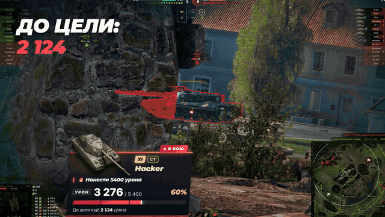
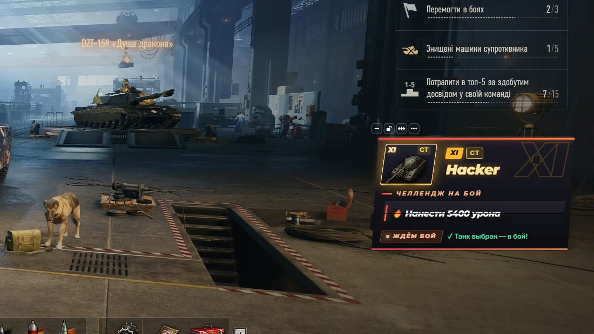
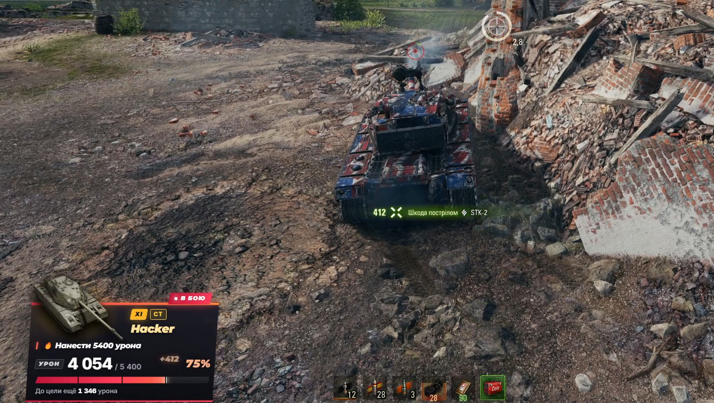
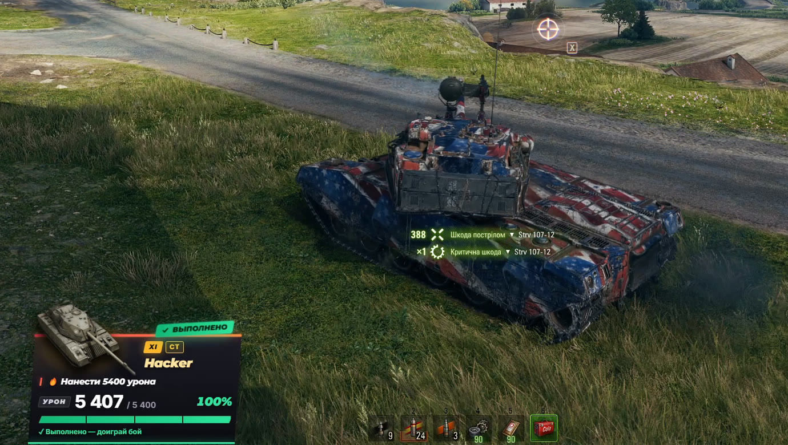
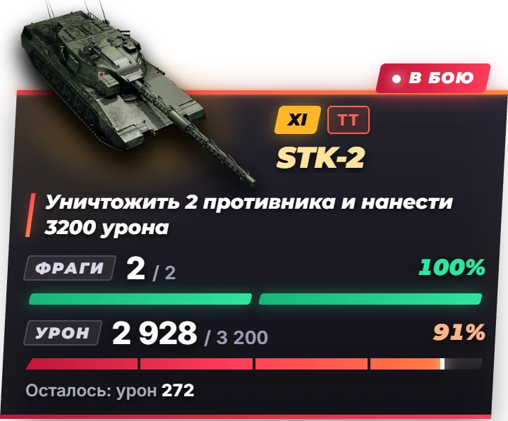
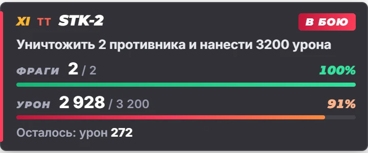

# Танковая рулетка для стрима

  

  <a href="https://volodyka1.github.io/wot-roulette/media/trailer.mp4"><b>▶ Смотреть ролик</b></a> (33 с, со звуком) ·
  <a href="https://volodyka1.github.io/wot-roulette/"><b>Открыть рулетку</b></a>

Рулетка выбирает случайный танк из ангара World of Tanks и челлендж на бой. Стример и его друзья крутят каждый у себя, а результаты всех собираются в виджеты OBS у стримера. Челлендж видно прямо в игре: прогресс идёт вживую, а итог боя засчитывается сам — сразу по данным игры или по статистике Wargaming.

Сайт: https://volodyka1.github.io/wot-roulette/

## Как это выглядит

**В ангаре** — выпавший челлендж и подсказка, тот ли танк выбран:

**В бою** — урон и фраги считаются вживую, после каждого попадания «+N»:

**Выполнено** — прямо в бою, не дожидаясь его конца:

**Два вида окна** — «Эфир» и компактный «Минимал», переключаются в панели:

  
  

Музыка в ролике: Dire Straits — «Money for Nothing».

## Как пользоваться

1. Стример входит через Wargaming, создаёт комнату и добавляет ники друзей в список.
2. Друзья открывают «ссылку для друзей», входят через Wargaming и крутят у себя.
3. В OBS стример добавляет источники «Браузер» со ссылками из карточки «Комната»:
   - «Команда» — 960×320, три танка в ряд с челленджами и итогами;
   - «Серия» — 560×300, серии выполнений и провалов.
4. После каждого боя результат челленджа появляется сам (обычно через несколько секунд, иногда через пару минут). Ручные челленджи стример отмечает кнопками.

Wargaming API видит только танки, на которых сыгран хотя бы один бой.

## Два режима проверки боёв

В панели, в карточке «Проверка боёв», выбирается, откуда брать итог:

- **Через Wargaming** (по умолчанию) — итог приходит из статистики Wargaming: обычно за секунды, иногда через пару минут. Работает у всех, ничего ставить не нужно. Панель стримера проверяет и свои челленджи, и челленджи друзей — другу достаточно войти на сайте, чтобы крутить.
- **Сразу из игры** — панель подключается к моду WotStat «Виджеты» на этом же компьютере и записывает итог сразу после боя. Игра присылает статистику всех участников боя, поэтому у стримера засчитываются и челленджи друзей, которые были с ним в бою (во взводе), — друзьям мод не нужен (например, тому, кто играет через GeForce NOW). Медали и свой опыт тоже засчитываются по итогу боя из игры. Всё, чего игра не видела, — бой друга без стримера и опыт друзей (премиум друга игра не сообщает), — по-прежнему проверяет Wargaming. Итог, пришедший из игры, помечен в истории «⚡ из игры».

При первом включении режима «Сразу из игры» браузер может спросить разрешение на доступ сайта к приложениям на этом компьютере — его нужно дать, иначе панель не увидит мод.

## Окно прямо в игре

С модом [WotStat «Виджеты»](https://wotstat.info/widgets) (бесплатный, есть версия для World of Tanks) челлендж видно в самой игре:

1. Установите мод: [установщик WotStat](https://wotstat.info/install?preset=widgets) или файл `.wotmod` в папку `mods/<версия игры>`.
2. В панели, в карточке «Комната», скопируйте ссылку «В игре (мод WotStat)» — у каждого игрока своя.
3. В игре: уведомление мода или список модов → «Добавить виджет» → вставьте ссылку. Окно свёрстано в ширину 360 и целиком растягивается под ширину, которую выставите в игре; высоту мод подгоняет сам.

Окно в стиле плашки со стрима («Эфир»). Новый спин прямо в ангаре прокручивает ленту рулетки: танк встаёт под маркер со вспышкой, печатается название, табло перелистывает челленджи. Дальше окно подсказывает, тот ли танк выбран; в бою сверху на рамке стоит танк, на котором играешь (сереет, если уничтожен), а прогресс идёт вживую крупными цифрами — полоса с делениями для урона, деления для фрагов и засвета, «+520» после каждого выстрела, у челленджа «или» ярче тот вариант, что ближе к цели; на «выполнено» — короткая вспышка и штамп. После боя — итог по данным игры, затем официальная проверка из комнаты. Ниже — челленджи друзей. Окно только показывает: итог в комнату по-прежнему записывает проверка в панели.

Пока ничего не происходит, окно стоит неподвижно — это требование, а не украшение. Мод пересылает игре каждый перерисованный кадр окна, и бесконечная анимация (хватило одной мигающей точки) при свёрнутой игре переполняет память её интерфейса: клиент вылетает примерно через семь минут. Поэтому всё движение в окне короткое и конечное, а раз в две секунды страница сама гасит анимации, которые не заканчиваются (`efQuiet` в `obs.html`).

Посмотреть без игры: допишите к ссылке `&demo=1` (по кругу: прокрут, ангар, бой, итог) или одну стадию — `&demo=spin|hangar|wrong|battle|after|ok|fail`. Без друзей: `&friends=0`.

## Устройство

- `index.html` — панель (рулетка, ангар, комната, челленджи).
- `obs.html` — виджеты OBS (`?room=ID&w=team|series|main|feed|board`) и окно для игры (`&w=game&acc=ID`, данные боя — data-provider мода WotStat на `ws://localhost:38200`).
- `js/catalog.js`, `js/tracker.js`, `js/room.js` — челленджи, проверка боёв, комнаты в Firebase.
- `js/gamelink.js` — связь панели с модом WotStat на этом компьютере: итог боя сразу из игры (режим «Сразу из игры»).
- `database.rules.json` — правила доступа Realtime Database (вставляются в консоль Firebase).
- `docs/SPEC-multiplayer.md` — описание данных и правил игры.
- `start.bat` / `serve.ps1` — локальный сервер для игры без комнаты (http://localhost:8080).
